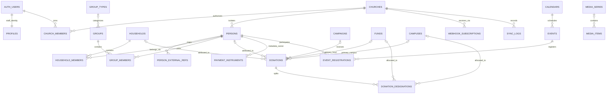
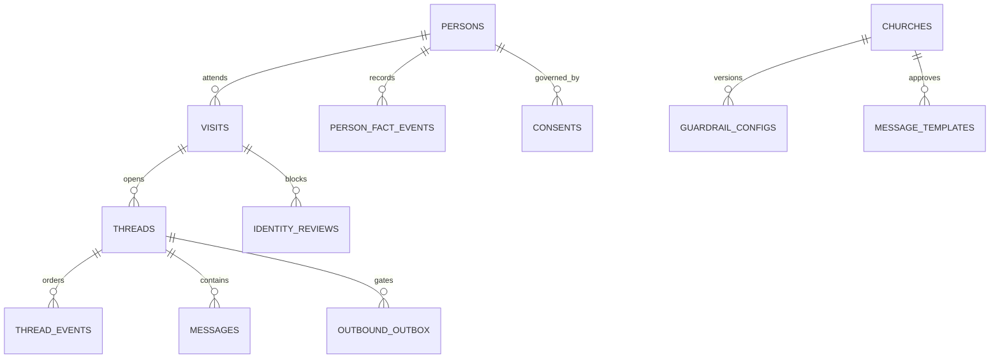

# 1Stayz — Database Architecture, Policies & QA Reference

Version 1 - engineering reference draft
Date: 9 October 2026
Audience: Full-stack engineers, database/security engineers, QA engineers and architecture reviewers
Primary source: subsplash api specs and associated shared docs in slack #all-engineering channel
Status: Proposed database-level reference; architecture/security approval required for new policies

## 1. Purpose, scope and reading guide

This is the refined replacement for the Subsplash database ERD, not a separate naming guide or a change summary. It retains the source's people, household, group, giving, calendar, media and synchronization domains, while replacing contradictory access patterns with a consistent church-tenant database architecture. Full-stack engineers should use it to design tables, queries, RPCs, migrations and tests. [file:1]

Supporting inputs are the supplied Supabase onboarding migration, setup guide, tests, naming conventions and AI/data-isolation guidelines. Existing objects are identified separately from future requirements. The architecture PDF filename says v1.4, but its cover/change log identifies v1.3 dated 8 October 2026; confirm its authoritative version before approval. [file:2][file:3][file:4][file:7][file:8]

Labels:
- Existing: visible in the supplied migration; not independently verified in deployment.
- Target: refined required behavior; implementation may need new migrations.
- Optional: retained Subsplash domain coverage, not automatically pilot scope.
- Decision: business/security contract requiring approval before dependent functionality ships.

MUST/MUST NOT denote target requirements. SHOULD denotes a recommendation requiring an explicit decision if not adopted. SQL and code examples are illustrative unless marked Existing; they are not a complete executable migration.

Reading path: architecture/boundaries (§2–4) → entities/relationships (§5–7) → state/data policies (§8–12) → full-stack integration (§13) → migrations/operations (§14–16) → QA/release (§17–19).

## 2. Architecture and non-negotiable invariants

One canonical tenant is a church. Its UUID is `public.churches.id`. Subsplash organization keys are protected external mappings, not a second tenancy root. Staff identity is Supabase Auth; guest people are separate tenant records. [file:2][file:3]

Target trust boundaries:
```text
Browser staff session -> Supabase API -> membership-derived tenant -> RLS tables/RPCs
Verified webhook -> trusted integration mapping -> RLS-bound worker -> tenant transaction
Tenant AI runtime -> church-scoped retrieval/facts/memory -> approved model provider
Restricted insights builder -> consent-filtered privacy releases -> Network Insights reader
Deployment pipeline -> privileged migration identity -> reviewed schema changes
```

Database invariants:
1. Every tenant-owned row has an explicit church key; every tenant relationship enforces equal church keys.
2. Tenant selection never becomes authorized merely because a client supplied a UUID or added a WHERE clause.
3. Ordinary runtime identities cannot bypass RLS, own tenant tables, create roles or run DDL.
4. SELECT permission does not imply write or sensitive-content permission.
5. Approval, identity resolution, consent, mode and dispatch transitions are protected commands, not generic editable fields.
6. Provider events are deduplicated without suppressing legitimate successive updates.
7. Safety state, not timeline order alone, determines whether outreach is allowed.
8. Raw identifiable data never reaches Lifeverse cross-church queries; only approved aggregates and eligible de-identified patterns do. No pilot conversations train models. [file:7]
9. Audit and event history are append-only for ordinary runtime, while authorized retention/erasure remains possible.
10. Applied migrations, policy behavior, effective grants and runtime tests—not the ERD alone—establish release readiness.

The source's raw cross-org analytics role, per-person/per-org PostgreSQL roles, broad service account and application-only filters are superseded. Its dynamic role-management SQL is not a target implementation pattern. Its role-count assertion is not adopted as a PostgreSQL limit. [file:1]

## 3. Database identities and authorization matrix

| Database principal | Intended boundary | Allowed | Forbidden |
|---|---|---|---|
| `anon` | Unauthenticated browser | Auth endpoints; no app-table/RPC access | Tenant data and onboarding commands |
| `authenticated` | Signed-in staff | Self profile, active church data and authorized commands | DDL, bypass, arbitrary memberships/audit writes |
| `app_worker` | Trusted dedicated direct-login backend | Approved tenant runtime commands and required tenant tables under RLS | Bypass, table ownership, arbitrary roles/DDL |
| `stayz_aggregator` | Network Insights reader | SELECT on approved privacy-release relations in `agg` | Raw persons/messages/facts/vectors/checkpoints; unsuppressed intermediate data |
| Restricted insights builder | Proposed controlled computation boundary | Minimum consent-authorized source metrics and release generation | Agent-accessible raw-content extraction or general admin credentials |
| Deployment principal | Migrations only | Reviewed DDL and necessary migration DML | Application/agent runtime use |
| Supabase `service_role` | Exceptional trusted administration | Approved auth/Vault/administrative tasks | Browser credentials or general tenant agent/worker execution |

The builder is distinct from the reader because source computation requires access the reader must not have. Its exact columns, ownership, credentials, invocations and audit are a Decision. No reader view GRANT alone proves suppression or de-identification.

Application capabilities are tenant membership data, not PostgreSQL role names. Titles are descriptive, while verified authority is a separately controlled capability.

| Feature | Ordinary staff | Owner/admin | Care-authorized staff | Verified pastoral approver |
|---|---|---|---|---|
| Read general church settings | Yes | Yes | Yes | Yes |
| Edit onboarding drafts | No | Yes | With admin capability | With edit capability |
| Read C3 care content | No | Only with care capability | Yes | Only with care capability |
| Invite/manage staff | No | Protected workflow | With admin capability | With admin capability |
| Approve CRI/templates | No | Not by role alone | Not by role alone | Protected approval command |
| Start Shadow/pause | No | Yes | With mode capability | With mode capability |
| Switch Live | No | Not by role alone | Not by role alone | Verified authority plus readiness |
| Giving/payment metadata | No by default | With domain capability | With domain capability | With domain capability |

Current onboarding implementation requires both `senior_pastor` title and owner/admin write permission for approvals/Live. It does not yet implement this target verified-capability model. [file:2]

## 4. Tenant context, RLS and privileged functions

### 4.1 Browser context — Existing

`app.current_church_id()` derives church from `auth.uid()` → `profiles.active_church_id` → active `church_members` row. Client IDs identify requested resources but never establish authority. Removing membership revokes subsequent database requests without waiting for JWT expiry. `profiles` is self-identity scoped, not a guest table. [file:2][file:3]

### 4.2 Worker context — Target

Use a dedicated direct login matching the helper's `session_user = 'app_worker'` branch. Verify webhook authenticity and resolve endpoint/provider-account/number/mailbox to church server-side. Do not trust a payload church ID. A custom setting is only trusted because the middleware identity is trusted; it is not independent authentication.

```sql
BEGIN;
-- Resolved UUID is a bound value, not concatenated input.
SELECT set_config('app.church_id', :resolved_church_uuid, true);
-- Execute approved tenant operation on this same transaction/connection.
COMMIT;
```

Use transaction-local context. Reused pools MUST be tested after commit, rollback and errors. SET ROLE does not change session_user; role-switching connections require a reviewed helper design. Current helper prioritizes auth.uid before worker context, so worker connections must not retain staff JWT state. Missing context returns no tenant rows; malformed/nonexistent context errors or denies, never broadens access.

### 4.3 Policy and grant rules

Every tenant table has RLS plus explicit command-level policies:
- SELECT: matching church plus feature/class capability.
- INSERT: WITH CHECK validates tenant, capability and permitted shape.
- UPDATE: USING authorizes old row; WITH CHECK validates new row; protected fields remain outside generic grants.
- DELETE: explicit capability and lifecycle states; history is not ordinary deletable data.

Policies for different features must be reviewed together because adding a permissive policy can broaden access. Policy presence is insufficient evidence of correctness. New policy names may use `rls_<table>_<command>`; retain existing names unless intentionally migrated.

Explicitly revoke/grant table, column, sequence and function privileges instead of relying on environment defaults. Review effective/inherited access and default privileges for each actual object-creating owner. Runtime roles must not have superuser/BYPASSRLS/CREATEROLE or an inherited privileged role-switch path. FORCE RLS is recommended where compatible with intended owner/definer workflows, with tests; it does not constrain superuser/bypass credentials.

SECURITY DEFINER requires qualified objects, fixed safe search_path, reviewed least-privileged ownership, restricted EXECUTE signatures, explicit caller/tenant/capability checks and atomic transitions. Document intentional bypass paths. No arbitrary SQL, role-creation or broad tenant-administration helper is exposed to clients. Tenant-facing views use security_invoker by default. Aggregate-release views need their own privilege/privacy design.

## 5. Schema, keys and common field contracts

Preserve existing plural names and IDs. New tables use lowercase snake_case and plural names; UUID `id` is local unless a documented composite/identity key is appropriate. `church_id uuid NOT NULL` belongs on tenant data, junctions, memory, facts and events.

Documented exceptions: churches uses id as the root; profiles is self-identity scoped; pilot_allowlist is global restricted control data; system/platform artifacts have explicit scopes; existing audit_log permits nullable church for documented system events. Exceptions require registry entries and tests, not a blanket schema exemption.

Schemas: public for exposed tenant/API tables; app for private helpers; agg for released outputs. Retain existing public.audit_log; moving to audit requires a migration and API/grant changes. Supabase-managed auth/storage follow platform contracts.

Shared field rules:
- Absolute instants use timestamptz. Local schedules use time plus validated IANA timezone.
- Local created_at/updated_at are separate from source_created_at/source_updated_at/synced_at.
- Required labels are trimmed/nonempty; enums, numeric ranges and JSON shapes are constrained.
- JSON has allowed keys, schema version, size limits and explicit secret/content restrictions.
- Tenant IDs, authoritative actors, approval evidence and computed fields are not client-editable.
- Provider IDs are external references, not local PKs. Keys are tenant/provider/resource scoped; a provider-specific table can use church_id/external_id when scope is unambiguous.
- Phone/email are match candidates, not globally unique person identity. Shared households require review.

Same-tenant enforcement pattern, illustrative:
```sql
ALTER TABLE public.persons
  ADD CONSTRAINT persons_church_id_id_key UNIQUE (church_id, id);
ALTER TABLE public.visits
  ADD CONSTRAINT visits_person_same_church_fk
  FOREIGN KEY (church_id, person_id)
  REFERENCES public.persons (church_id, id);
```

Apply to every parent reference, including nullable ones, plus both parents of junctions. RLS alone does not establish parent/child tenant consistency. Index tenant/filter/order access paths and child FK joins. Choose CASCADE/RESTRICT/SET NULL explicitly for each lifecycle; financial retention must not be an incidental person-delete cascade.

## 6. Entity reference: refined Subsplash model

This replaces the 22-entity source catalog rather than retaining obsolete schema instructions. Fields are design candidates, not confirmation of current provider API availability. All optional tables inherit §5's tenant keys, timestamps, classification and scoped references. [file:1]

### 6.1 Identity and provider mapping

| Source | Refined target | Contract |
|---|---|---|
| Organization | Existing churches plus protected provider organization mapping | Canonical church UUID; provider/key mapping verified server-side; conflicts halt ingestion |
| User | Supabase auth.users + existing public.profiles | No custom password_hash; self profile separate from guests |
| UserOrganization | Existing church_members | Protected church/user membership, title, access role and status |
| Profile (provider person) | Target persons + person_external_refs | Local person UUID, tenant-scoped source mapping, reviewed matching |

persons candidates: first_name, last_name, normalized contact references, membership_status, source, needs_review, shared_contact, metadata and optional authorized birth date. Direct contacts/names are C1. Care facts are restricted C3. Consider person_contacts for multiple/shared contacts. Do not auto-link staff auth users to guests by email.

person_external_refs: church_id, person_id, provider, resource_type, external_id, source version/times; unique church/provider/resource/external ID; same-tenant person FK. Provider organization uniqueness must follow discovered provider semantics rather than an assumed global key.

### 6.2 Households and groups — Optional

| Entity | Domain fields | Integrity/access contract |
|---|---|---|
| households | name, address components, phone, external reference | People capability; contact/address C1; historic donor links handled explicitly |
| household_members | household_id, person_id, household_role | Same-tenant FKs; unique household/person per church; validated head/spouse/child/other |
| group_types | name, description | Optional tenant normalized-name uniqueness; referenced types protected from careless deletion |
| groups | name, description, group_type_id?, leader_person_id?, external reference | Same-tenant optional type/leader; group administration capability |
| group_members | group_id, person_id, role, joined_at, left_at? | left_at >= joined_at; one active membership if historical rows retained |

Care/counseling group membership may itself be sensitive; not every group record is ordinary directory data. No automatic fuzzy household/person merge during pilot.

### 6.3 Giving and payment metadata — Optional, separately approved

| Entity | Domain fields | Validation/ownership |
|---|---|---|
| campaigns | name, description, goal_amount, raised_amount, start_date, end_date?, status | End >= start; explicit currency if needed; provider-reported vs locally computed totals distinct |
| funds | name, description, is_active | Inactive funds remain linked to historical gifts |
| campuses | name, address, is_active | Classified addresses; retain historic associations |
| donations | person_id?, household_id?, campaign_id?, fund_id?, campus_id?, amount, fees, net_amount, currency, auth_date, status, frequency, memo?, donor_covered_fees, has_adjustments, instrument_type, is_recurring | Same-tenant FKs; exact decimal money; documented gross/fee/net and anonymous-donor rules |
| donation_designations | donation_id, fund_id?, campus_id?, amount | Same-tenant FKs; stable source line identity; locked split reconciliation |
| payment_instruments | person_id, type, last_four?, expiry_month?, expiry_year?, is_default, external reference | No PAN/CVV/full bank account or reusable payment credential; month 1..12; scoped default uniqueness |

Use numeric, not floating point. Approve currency/precision/minor-unit assumptions before coding. Refunds/adjustments are explicit history, not silent original-row overwrites. Do not blindly enforce nonnegative values if provider reversals use signed amounts. Cross-row split sums need controlled transactions or appropriate deferred validation, not a row CHECK pretending to validate totals.

Giving requires domain capability; owners/agents do not automatically see donor history. Memos can contain C1/C3. Giving is not automatically an approved Lifeverse metric. Financial retention/anonymization is a separate approved policy.

### 6.4 Calendars, events and media — Optional

| Entity | Domain fields | Integrity/data policy |
|---|---|---|
| calendars | name, description, is_active, external reference | Historic events survive calendar deactivation |
| events | calendar_id, title, description, start_at, end_at, all_day, location, is_recurring, recurring_pattern, status | Same-tenant calendar; explicit interval, timezone, all-day and recurrence semantics |
| event_registrations | event_id, person_id, status, registered_at, checked_in_at? | Same-tenant FKs; event/person uniqueness unless multiple tickets supported; consistent check-in state |
| media_items | title, description, media_type, url, thumbnail_url?, duration_seconds?, published_at?, status, series_id? | Same-tenant series; valid URL schemes; nonnegative duration; authorized fetch host policy |
| media_series | title, description, start_date?, end_date?, status | Date ordering and tenant-scoped source key |

Registration is not attendance unless the provider contract confirms it. Return-next-week metrics require real attendance signals. Public sermon availability does not automatically authorize cross-church training; church-specific doctrine remains C4 retrieval content.

### 6.5 Webhooks and synchronization — Target when integrations enabled

webhook_subscriptions: church_id, provider, provider_subscription_id, endpoint identifier/URL, secret_ref, credential version, event allowlist, active state. Opaque secret references replace ordinary secret columns. Only trusted integration administration changes routing/credentials.

integration_events (proposed): church_id, source, source_event_id, subtype, resource reference, event/received times, processing state, attempts, safe error code. Distinguish source-event identity from object/message identity. Restricted time-bounded raw payload storage is optional and excluded from central logs.

integration_sync_state (proposed): church_id, integration_id, resource_type, cursor/watermark, last_success_at, lease, backoff, adapter version. Unique church/integration/resource; progress advances only after durable processing.

sync_logs: church_id, integration/resource reference, action/result, attempt/correlation ID, processed_at and bounded sanitized failure category. Provider IDs remain restricted C1. This is processing evidence, not a replacement for security/configuration audit.

## 7. Existing onboarding and proposed runtime schemas

### 7.1 Existing migration inventory

Existing tables: pilot_allowlist, churches, profiles, church_members, church_invites, service_schedules, ministries, integrations, church_documents, guardrail_configs, staff_contacts, message_templates and audit_log. Existing church_readiness is security_invoker. These objects preserve their shipped names. [file:2]

- service_schedules: weekday 0..6, start/end, confirmation; current SQL requires end > start and does not model overnight services.
- ministries: tenant case-insensitive name uniqueness.
- integrations: provider/status/method/non-secret settings; one provider per church in current schema.
- church_documents: private object metadata with tenant-folder consistency.
- guardrail_configs/message_templates: versioned draft/pending/approved/superseded state and approval evidence.
- staff_contacts: C1 contact routing, including contacts without auth login.
- audit_log: safe change metadata, protected browser writes; intentional survival after church deletion. [file:2][file:3]

### 7.2 Target messaging/AI tables

| Table | Minimum database contract |
|---|---|
| visits | Church/person, intake source, service-end timestamp, contact deadline, needs_review, SLA outcome |
| threads | Church/visit/person, ownership state, monotonic version, sequence allocation |
| thread_participants | Church/thread, contact/participant reference, channel |
| messages | Church/thread, direction, body, data_class, provider identity and lifecycle state |
| thread_events | Church/thread, type/source/event identity, source/receive/effective times, seq, skew, causation |
| consents / consent_events | Contact/channel/purpose current state plus immutable evidence/wording history |
| identity_reviews | Candidate matches, reason/confidence, open/resolved state, actor/resolution |
| person_fact_events | Field/value/class/source/event identity/times/confidence/actor/correction reference |
| outbound_drafts / outbound_outbox | Input version, approved config/template references, dedup key, claim/status, provider receipt |
| model_call_logs | Model/version, retrieved IDs, config, tokens/latency; no centrally stored raw prompts |
| knowledge_chunks / agent_checkpoints / agent_store | Explicit church scope, class/retention, authorized retrieval |
| church_learning_consents | Permission/evidence versions for patterns/aggregates/naming; training false during pilot |

These objects are not in migration 001. Their concrete DDL, enum values, RPC signatures and indexes are separate reviewed deliverables. [file:2][file:7]

### 7.3 Refined relationship diagrams





Root edges are omitted from some optional tables for readability; all remain church-owned. Diagram cardinality does not replace constraints or permissions.

## 8. Approval, membership and Live-mode policies

Self-selected senior_pastor title and invitations bearing that title cannot be sufficient verified approval authority. Target capability grants have church/user/capability, verified-by, evidence and grant/revoke times. Approval authority is granted/revoked only by an approved workflow; production MFA assurance is recommended pending policy approval. [file:2][file:3]

Target approval state machine: draft → pending_approval → approved → superseded. Approved/superseded tenant, content, family, version and approval evidence are immutable. Only constrained supersession changes approved to superseded. Current trigger trusts `app.superseding` and does not compare all remaining fields in its allowed transition; replace that escape path rather than trusting caller-set custom variables. [file:2]

Serialize approval per church/family; add partial uniqueness for one approved guardrail per church, one approved template per church/family, and agreed selected-template scope. Preserve all history. Enforce at most one active owner with an index; creation/transfer/removal commands preserve at least one owner where required. Allocate versions under a lock or safe conflict/retry strategy.

Church creation atomically claims allowlist, checks membership, creates church/owner/profile and audit. Current prechecks need locking/serialization hardening for concurrent calls. Invite acceptance locks/claims valid confirmed-email invitations, handles safe replay and controlled reactivation. Decide one membership versus many; current invite acceptance can add multiple memberships, and no active-church-switch RPC is supplied. [file:2]

Live retains nine readiness items: profile reviewed, service schedule set, Subsplash connected, guardrails approved, escalation contacts set, first message approved, consent wording live, messaging ready and Shadow Sunday complete. Target readiness uses authorized evidence, not browser-manufactured connected statuses or timestamps. Confirmed valid schedule, reachable escalation contact and tested integration are required. Lock church before readiness evaluation/mode change; readiness-changing commands share that lock protocol. Define pause behavior after safety-critical revocation. [file:2][file:3]

## 9. Integration ordering, identity and fact provenance

Verify actual provider endpoints, signatures, replay controls, field availability, rate limits, cursor semantics, timestamps and attendance signals before coding adapters. The source ERD is conceptual, not current API verification. [file:1]

Use source-record UPSERT scoped by church/provider/resource/external ID. Event deduplication uses delivery/event identity, not only object identity. Multiple updates/statuses for one message SID may be legitimate separate events; define subtype/version keys per adapter. Failed transactions do not advance cursors. Use bounded backoff, reconciliation/overlap windows, durable receipt and dead-letter/review handling.

Each thread event carries source event_at, server received_at, derived effective time, source trust, clock_skew, per-thread seq and causal reference. Default missing/outlier timestamp tolerance is five minutes with received-time fallback. Ordering uses effective time, trust tie-break then seq. App actions use server commit evidence; Twilio uses provider timestamps; email uses provider receipt rather than sender Date; Subsplash uses submission time or fallback. Model results follow causal inputs even if clocks disagree. Event insert/sequence/version are atomic. [file:7]

Identity resolution is tenant-local. Contact plus matching normalized name can link confidently; shared contact/name differences, alternate email or uncertain household patterns create review candidates and block outbound. Staff resolve same person/different person/shared contact/do not contact. No auto-fuzzy merge. Unresolved service-end +30-minute deadline is recorded missed; safety wins over SLA. [file:7]

Facts are append-only events. Derived card precedence is staff > guest-stated > Subsplash > model-inferred, then trusted recency. Explicit correction/supersession differs from unresolved contradiction. Ambiguous top-precedence facts are marked conflicted, omitted from model context and shown to staff. Corrections append evidence, not overwrite history. Erasure/retention applies to fact history. [file:7]

## 10. Outbound dispatch database contract

Before dispatch require: Live mode; current approved config/template; local and provider consent/opt-out state; current draft thread version; agent ownership/no escalation; no person/visit identity review; guest-local quiet hours. Unknown required evidence, timezone or provider state fails closed until approved resolution.

A database transaction cannot atomically commit an external provider send. Refine the guideline's transactional gate into an outbox workflow rather than claiming distributed atomicity:
1. Persist deduplicated outbound intent and input version.
2. Check required provider safety state immediately before local claim.
3. In a short transaction lock relevant consent/contact and thread, validate current state/version and issue one dispatcher claim.
4. Send using supported provider idempotency controls; persist provider receipt.
5. Reconcile uncertain sends before retry; serialize dispatchers and safety-state updates through a common protocol.

Late STOP/takeover between local claim and external send remains a distributed race requiring explicit mitigation/provider enforcement. Do not claim exactly-once delivery without end-to-end support. Database retries must not blindly repeat external effects.

Blocked reason codes include opted_out, stale_draft, staff_owned, needs_review, quiet_hours, not_live, config_unapproved and provider_unavailable. Audit safe reasons/IDs, never blocked message bodies. Shadow produces reviews/drafts, not guest outreach. [file:7]

## 11. Classification, AI memory and aggregate policies

C1 direct identifiers stay tenant-only. C2 quasi-identifiers require generalization before permitted patterns/aggregates. C3 sensitive care/crisis content is role-restricted, never pattern text even paraphrased; approved counts only. C4 church proprietary stays tenant-only except explicitly consented categories. C5 patterns require eligibility/de-identification. C6 platform-authored artifacts have explicit platform scope. Mixed records apply the union of restrictions; uncertain classification fails restrictive. Tag messages/fact events and maintain a structured field registry. [file:7]

No C1/C3 embeddings. Vectors/checkpoints/store use church RLS; tenant-prefixed keys alone are not authorization. Checkpoints compact after visit window +30 days per approved retention. Context builder checks every item's church UUID; caches are church/config-version scoped. Model audit records provider/version/doc IDs/config/tokens/latency, not identifiable centrally stored prompts. [file:7]

Network Insights:
- Reader sees only releases with consent filtering and suppression already enforced; no raw/intermediate sources.
- Approved pilot metrics include visit counts, service-end contact SLA, reply rate, question categories, escalation counts, opt-out rate, average turns and validated returns.
- Default k=5 distinct persons, not rows; at least two churches contribute unless authorized named sharing applies (not pilot). Apply stricter configured participant thresholds.
- Review totals/denominators, differencing, query allowlists and rate limits; audit safe principal/metric/dimension/policy/suppression evidence.
- Patterns require church permission, guest improvement consent, successful de-identification, no C1/C3/C4 and generalized C2. Opt-out stops future contribution.
- Training remains false during pilot; later requires separate authorization gates. Correct earlier internal section references to the training gate in §6.5 of the guidelines.
- Stable salted church hashes are pseudonymous, not automatic anonymity; salt/mappings never reach agents. Quarterly rotation and retained output require privacy review. [file:7]

## 12. Audit, storage, retention and erasure

Audit is append-only for ordinary runtime and records actor/service, safe tenant/entity IDs, action and changed column names, not C1/C3 values, raw errors or secrets. IDs still require access/retention controls. Existing audit intentionally survives church deletion; define de-identification of retained metadata. [file:2]

Private church-documents bucket uses `{church_id}/{uuid}-{file}`, PDF/DOCX, 20 MB, tenant read and authorized admin upload/delete. Verify actual bucket privacy, folder policies, signed-URL lifetimes, scanning/sanitization and metadata/object reconciliation. Private storage does not validate content. [file:2][file:3]

Secrets are Vault/approved secret-manager entries; tables store opaque refs and allowlisted non-secret settings. Do not expose provider errors/request bodies/tokens in sync logs, APIs or central observability.

Export/erasure inventory covers relational rows/facts, storage, vectors, checkpoints, caches, queues/jobs and retained copies. Define contractual windows, financial exceptions and backup expiry. Restore procedures reapply approved erasure. Do not promise instant removal from all backups or unconditional retention of allegedly anonymous outputs. Licensed learning retention depends on actual permission/de-identification. [file:7]

## 13. Full-stack integration patterns and API contracts

### 13.1 Existing interfaces

| Operation | Existing contract | Important restriction |
|---|---|---|
| Church creation | `create_church(p_name,p_website_url,p_your_name,p_title)` | Confirmed email, allowlist and membership gate; target authority hardening still needed |
| Invitation acceptance | `accept_pending_invites()` | Confirmed email; refresh staff membership afterward |
| Read readiness | church_readiness SELECT | Database determines authorized church |
| Mode change | `set_church_mode(p_mode)` | Current owner/admin; Live also senior_pastor and readiness |
| Own profile | profiles SELECT/UPDATE full_name | active_church_id protected |
| Onboarding edits | Granted columns/tables | Owner/admin and RLS; readiness evidence target stricter |

Proposed approve_guardrail/approve_template/resolve_identity_review/switch_active_church/claim_outbound commands do not yet exist. Migrations must ship exact signatures, return schemas, grants and error categories before frontend use. [file:2][file:3]

Browser example using existing schema:
```typescript
const { data, error } = await supabase
  .from('churches')
  .select('id,name,timezone,mode,onboarding_step')
  .single();
if (error) throw error; // Classify no active tenant vs auth vs operational failure.
```

Use explicit projections and bounded pages. URLs/forms/cache IDs are untrusted. No direct browser database URL/service key. Client tenant filters may improve UX but never replace policy checks.

Worker sequence: verify source → resolve church → begin worker transaction → set local context → claim event → validate/write domain state/event/version/audit → commit durable receipt → acknowledge/process asynchronous work. If acknowledging before processing, durable retryable receipt must already exist. Bind values; dynamic identifiers use strict allowlists.

### 13.2 Error contract

| Category | Database evidence | Caller behavior |
|---|---|---|
| Permission | 42501 or reviewed invisible-resource result | Safe unavailable/denied; no other-tenant details |
| Duplicate | 23505 and known constraint | Recognized idempotent replay/conflict; do not ignore unrelated collisions |
| Relationship | 23503 | Safe invalid relationship; no inaccessible parent existence leak |
| Validation | 23514 or reviewed custom code | Safe field errors |
| Serialization/deadlock | 40001/40P01 | Bounded server retry of whole idempotent transaction; no repeat send |
| Business state | Stable reason codes; current readiness uses P0001 | Safe missing-item/conflict list |
| Unknown error | Generic response with safe correlation ID | No raw SQL, payload, token or stack |

RLS UPDATE/DELETE may correctly affect zero rows rather than raise. QA asserts final unchanged state. Tests must not accept any arbitrary exception as proof of permission enforcement.

## 14. Transaction, concurrency and performance standards

Protected commands manage multi-row invariants; generic writes are limited to authorized low-risk draft/settings columns. Target shared lock ordering is church → contact/consent → thread → draft/outbox, with sorted IDs for multiples. All interacting paths must adopt/test the protocol; an illustrative order alone does not prevent races/deadlocks.

Atomic units: creation/allowlist/owner; invite/membership; approval/supersession; event/dedup/seq/version; identity review/link/flags; fact correction/conflict; outbox claim/safety; sync completion/cursor.

Use two independent connections and barriers for races; a single rollback suite cannot prove concurrency. Retry known transient SQL failures boundedly. Do not perform irreversible external effects inside retried transactions.

Performance policy: deterministic ordering/ID tie-breaks, keyset pagination for large histories, bounded page/statement sizes, tenant-first indexes where supported by actual plans, child FK indexes, no N+1/unbounded nested responses. EXPLAIN under actual runtime roles using representative sanitized fixtures. Never disable RLS to solve latency. Define numeric p95/p99, timeout, page-size, batch-size and concurrency budgets before performance sign-off; no unstated SLA is assumed. Tenant vector optimization must preserve scope/classification and measured retrieval quality.

## 15. Migrations and environment isolation

Separate Supabase projects dev/staging/prod, with project/environment identity asserted at boot. `stayz_<env>` logical labels need not equal managed physical database names. No staging-to-production database/telephony credentials. Auth URLs, SMTP, providers and recovery configuration require separate verification. [file:3][file:8]

Canonical new filenames: Supabase `<YYYYMMDDHHMMSS>_<card-id>_<slug>.sql`; retain shipped `20261002000000_auth_onboarding.sql`. Never rewrite applied production migrations. Byte-identical -1 attachments are not separate migrations; exclude duplicates from migration directory. SQL tests live under supabase/tests.

Workflow: requirement/classification/tenant design → constraints/grants/RLS/commands/audit → clean reset and baseline upgrade → runtime-role tests → generated types/API contracts → CI → staging integration pass → approved production promotion. Explicit privacy checklist and database/security reviewer required; supplied conventions identify Dave Caspillo for database/RLS/audit/aggregation review, subject to confirmation of current ownership. Bolt must not generate unreviewed schema. [file:3][file:8]

## 16. Threat model and assurance boundaries

| Threat | Control | Evidence |
|---|---|---|
| Guessed tenant IDs/missing filters | Identity-derived RLS | Unfiltered/cross-tenant SQL and API tests |
| Forged role/title/context | Protected capabilities and trusted mapping | Tamper/approval/context tests |
| Cross-tenant parent links | Composite FKs | Insert/update attack fixtures |
| Pool bleed | Local context/dedicated worker identity | Reused connections after success/error |
| Replay/incorrect provider account | Verified mapping and event keys | Authenticity/replay/subtype tests |
| Approval/send race | Locked state commands/uniqueness/outbox | Independent-session schedules |
| PII in JSON/logs | Registry/projections/scrubbing | Canary scans |
| Aggregate re-identification | Released-output privacy boundary | k/distinct-person/denominator/differencing tests |
| Incomplete erase/restore | Data-copy inventory | Export/erase/restore rehearsal |

Database assurance does not certify provider delivery, legal consent adequacy, model-provider retention, frontend XSS or identity-provider settings. Define/test interfaces to those controls without presenting database transactions as an end-to-end guarantee.

## 17. QA strategy and acceptance cases

Fixtures: churches A/B, owner/admin, staff, care-authorized, verified pastor, staff-only pastor, removed user, confirmed no-member and anonymous callers. Include shared contact, open review, contradictory facts, drafts/approvals, consent revoked, repeated source IDs and valid/invalid parent links. Synthetic data only.

Local invariants may roll back; concurrency uses independent sessions/disposable database; staging tests exercise real auth/API/storage and worker pooling. Each result records test ID, role/context, expected SQLSTATE or row count, resulting invariant and safe diagnostics.

| ID | Action | Acceptance assertion |
|---|---|---|
| ISO-01 | B reads A by guessed UUID/unfiltered query | No A fields/errors revealing identity |
| ISO-02 | B inserts/updates/deletes A | Deny or zero rows as specified; A unchanged |
| ISO-03 | A moves tenant key or references B parent | Rejected; no cross-church relation |
| ISO-04 | Missing/malformed worker context | No broad access; writes fail closed |
| ISO-05 | A pooled request errors then connection reused by B | Only B context; no stale JWT/setting |
| AUTH-01 | Unconfirmed/non-allowlisted signup | Expected rejection; no church/claim |
| AUTH-02 | Simultaneous creation for same identity | One church/owner/allowlist use |
| AUTH-03 | Invite expired/replayed/concurrently accepted | No unauthorized/reactivated membership; one valid transition |
| AUTH-04 | Remove member and reuse old JWT | Subsequent access revoked |
| GRD-01 | Client picks/invites senior_pastor title | No verified capability gained |
| GRD-02 | Verified approver approves | Stamped actor/time, correct supersession, safe audit |
| GRD-03 | Mutate approved payload/version/tenant/family or flag | Rejected; payload unchanged |
| GRD-04 | Two approvals same family | Exactly one active approved version; history preserved |
| LIVE-01 | Omit each readiness item separately | Live denied with safe missing item |
| LIVE-02 | Spoof integration/milestone evidence | Cannot manufacture authoritative readiness |
| LIVE-03 | Revoke evidence during activation | Lock protocol preserves safety; stale evidence cannot authorize send |
| ORD-01 | Duplicate event replay | One logical side effect |
| ORD-02 | Legitimate statuses share message SID | Distinct events retained |
| ORD-03 | Clock outlier/ties/causal model result | Persisted fallback and deterministic causal order |
| IDN-01 | Shared contact, different person name | Review required; no merge/send |
| IDN-02 | Same/different/no-contact resolution | Correct links/flags and actor evidence |
| IDN-03 | Review unresolved at deadline | Missed SLA, not safety override |
| FCT-01 | All source priorities disagree | Defined precedence; full event history |
| FCT-02 | Unresolved top-level contradiction | Conflict omitted from model context |
| FCT-03 | Authorized correction | Appended correction, no overwrite |
| SEND-01 | Opt-out/provider unavailable/no evidence | No send; safe reason |
| SEND-02 | STOP/takeover after draft | Stale/blocked draft and documented external-race handling |
| SEND-03 | Double dispatcher/uncertain receipt | One claim; reconciliation before retry |
| SEND-04 | Quiet hours/DST/unknown timezone | Approved local-time rule/fail-closed result |
| DATA-01 | External ID reused across churches | Scoped mappings, no cross-tenant overwrite |
| DATA-02 | Duplicate junction or financial split mismatch | Intended unique/reconciliation invariant |
| AI-01 | Other-tenant vector/memory/cache item | Rejected; no C1/C3 embedding |
| AGG-01 | Below k persons or two churches | Suppressed including revealing totals/denominators |
| AGG-02 | Consent revoked / differencing / intermediate access | Exclusion/deny according to approved policy |
| OPS-01 | Other-tenant storage actions | Denied; metadata/object consistency |
| OPS-02 | Erase and restore older backup | Approved re-erasure verified |
| OPS-03 | Canary identifiers in failures/logs | No prohibited central content |
| PERF-01 | Representative data/concurrency | Approved latency/query budgets as runtime identity |

Structural checks inspect all registered objects, not only public tables. Include actual policy expressions, views, definer ownership, caller EXECUTE, effective/inherited grants and storage. Existing test guard only checks RLS plus policy presence and generic error helpers accept arbitrary exceptions; extend both. [file:4]

Illustrative privileged test-environment inspection:
```sql
SELECT rolname, rolsuper, rolbypassrls, rolcreaterole
FROM pg_roles
WHERE rolname IN ('authenticated','app_worker','stayz_aggregator');

SELECT n.nspname, c.relname, pg_get_userbyid(c.relowner) AS owner,
       c.relrowsecurity, c.relforcerowsecurity
FROM pg_class c JOIN pg_namespace n ON n.oid=c.relnamespace
WHERE n.nspname IN ('public','app','agg') AND c.relkind IN ('r','p');

SELECT schemaname, tablename, policyname, roles, cmd, qual, with_check
FROM pg_policies
WHERE schemaname IN ('public','app','agg','storage');
```

Diagnostic queries are not certification and must become explicit pass/fail assertions with an exception registry. Do not grant runtime catalog administration merely to simplify QA.

## 18. Implementation gap register and decisions

Static-review priorities:
- P0: remove legacy raw analytics/general privileged runtime; verify pastoral authority; constrain approval supersession; explicit grants and behavioral coverage; messaging/send safety before live outreach.
- P1: same-tenant keys/scoped IDs; creation/invite/approval/readiness concurrency; owner/current-approval uniqueness; protected integration evidence; secret/JSON validation; membership cardinality/active switching.

P0 is design/security priority, not a claim of demonstrated deployed exploitation. Deployment state is unknown; SQL/tests were reviewed but not executed against a live PostgreSQL/Supabase environment for this document. [file:1][file:2][file:4]

Decisions to close:
1. Confirm source PDF version and approve this naming/contract precedence.
2. Verify pastoral authority/delegation/MFA policy.
3. One membership versus multiple with one active church; switching contract.
4. Authoritative readiness evidence and automatic pause/revocation rules.
5. Guest-timezone fallback, overnight services, shared-household greeting.
6. Real Subsplash/provider event identity, timestamps, attendance, rate/cursor behavior.
7. Insights builder grants, release architecture, privacy thresholds and hash treatment.
8. Signed retention/backup/financial/offboarding policy.
9. Pilot domain scope; optional giving/full person graph remain disabled unless approved.
10. Numeric performance/reliability budgets and operational ownership.

## 19. Definition of done and release evidence

For each database feature:
- [ ] Entity scope/status, field types/nullability/defaults/classification and provenance documented.
- [ ] Tenant keys, scoped uniqueness, composite FKs and deletion rules implemented.
- [ ] Explicit privileges, command-specific RLS and protected state transitions implemented.
- [ ] Context resolution, pool reuse and sensitive capability tests pass.
- [ ] Multi-row invariants/concurrency and external-effect reconciliation tested.
- [ ] RPC/type/projection/error contracts handed to frontend/backend engineers.
- [ ] Named positive/negative QA cases assert intended errors and final state.
- [ ] Runtime query plans, pagination and approved numeric budgets measured.
- [ ] Audit/storage/export/erase/restore/privacy reviewed.
- [ ] Clean install and baseline upgrade tested; forward/rollback recovery documented.
- [ ] Staging real auth/storage/provider tests pass; secrets absent from browser/repo.
- [ ] Decisions closed or dependent functionality explicitly disabled.
- [ ] Architecture/security reviewer and production deployment approval obtained.

Release package: migration IDs, project/environment, effective grants/policy snapshot, test reports, concurrency schedules, query-plan evidence, restore/erasure results, privacy approval and deployment sign-off. This reference is the engineering contract; it does not replace that evidence.
