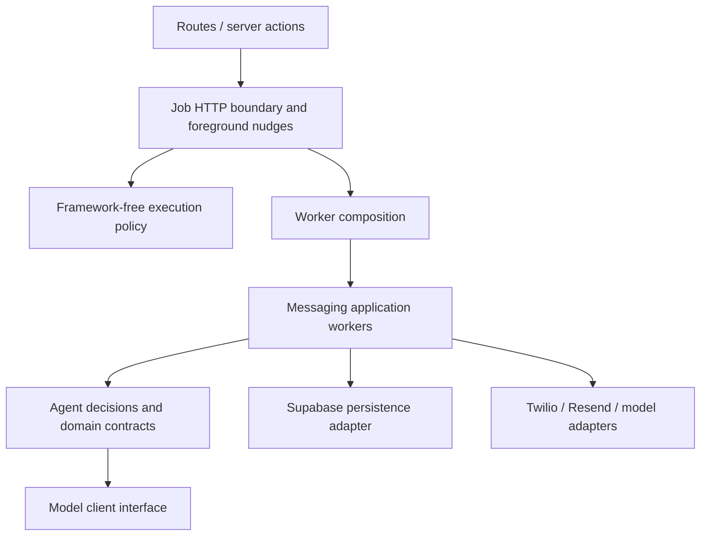

# Application architecture

## Decision and scope

Keep one deployable Next.js application backed by Supabase. Separate request handling,
application orchestration, decision logic, persistence and provider adapters inside that
application. Independent scheduled functions provide failure isolation without introducing
another deployment, broker, framework or service credential.

This change does not alter the database schema, consent rules, authentication behavior,
message content, approval roles or model choices. Existing database outboxes and leases
remain the source of truth. An HTTP response is not a delivery acknowledgement.

## Dependency direction

- `src/app/`: translate HTTP into application requests; no scheduling pipeline here.
- `src/lib/jobs/catalog.ts`: allowed job names, cadence assumptions and health policy.
- `src/lib/jobs/runner.ts`: finite work and deadline policy; injected executor, no service imports.
- `src/lib/jobs/execute.ts`: composition root selecting a worker and its claim size.
- `src/lib/jobs/http.ts`: cron authentication, execution result and per-job heartbeats.
- `src/lib/jobs/nudge.ts`: bounded, best-effort work after a webhook or server action response.
- `src/lib/messaging/`: application workers coordinating durable database work and providers.
- `src/lib/agent/`: decisions, prompts, escalation and validation, independent of Next.js,
  database clients, messaging workers and inbox presentation types.
- `src/lib/domain/`: shared vocabulary; inbox types re-export it for compatibility.
- `src/lib/supabase/`, `twilio/`, `email/`, `ai/providers/`: persistence and external IO.

ESLint rejects forbidden adapter/presentation imports from decision and job-policy modules.
Vitest exercises the execution, cancellation, authentication, schedule and health contracts.

## Independent scheduled jobs

All endpoints use the existing `Authorization: Bearer $CRON_SECRET` contract.

| Endpoint | Responsibility | Work per unit |
| --- | --- | --- |
| `/api/cron/messages` | Queue first contacts and deliver approved messages | At most one claimed message per configured channel |
| `/api/cron/tagger` | Classify new messages | One claimed message |
| `/api/cron/agent` | Decide and record guest replies/escalations | One claimed thread |
| `/api/cron/notifications` | Queue reminders and send staff/ops notifications | One claimed notification |
| `/api/cron/retention` | Compact stale conversation context | One existing retention RPC |

Each runs every minute in `vercel.json`, independently of the others. Queue ordering and
eligibility stay in SQL. Tagging does not have to precede agent execution: the agent's own
rules and review stages decide whether to escalate or hold a draft. Tagging starts from C3.
New approved agent drafts are picked up by the next delivery run, normally within a minute.

Scheduled execution stops at 20 units or a 40-second deadline, leaving time for health writes
inside the route's 60-second platform budget. These conservative limits are pilot capacity,
not a high-volume throughput guarantee. Monitor backlog age before raising limits or adding
bounded concurrency. A delivery unit can send at most two messages, one per configured channel.

## Cancellation and recovery

The runner passes an invocation-owned `AbortSignal` through workers to database, model,
Twilio and Resend requests. Model retry backoff also observes it. Provider requests retain
their shorter per-request timeouts. The shared database singleton is never assigned a job's
signal; jobs use scoped clients. No timeout is implemented as an uncancelled Promise.race.

`completed` means no more work was indicated. `yielded` means some units completed but the
work/deadline budget was reached. `timed_out` means the deadline elapsed before any unit
completed; it returns 503 and makes health unhealthy. Failures return 500 and are recorded
separately. Finishing a run does not mean every item was delivered: inspect worker results
for failures, retries and missing channel configuration.

Cancellation stops local IO; it cannot undo a provider acceptance or a database transaction
already running remotely. Existing outbox leases, SMS reconciliation and email idempotency
handle those ambiguous outcomes. A cancelled claim may wait for its existing lease to expire.
No database migration or data backfill is needed for this refactor.

Foreground nudges use one unit and a shared 35-second budget. An agent nudge also attempts
notifications and delivery within that same deadline. Failure leaves retry ownership with
the independent schedules. Nudges never update scheduler health records.

## Health and deployment

`/api/health` requires recent successful heartbeats for all five workers, not just delivery.
It returns per-job status ages and retains `cron_age_s` for delivery-monitor compatibility.
Worker failures, missing schedules and no-progress timeouts produce 503. Successful health
does not certify external delivery; provider results and backlog alerts remain necessary.

Deploy `vercel.json` with the code. Custom pg_cron/pg_net schedulers must call all five
endpoints every minute: the previous single `/api/cron/messages` call now does delivery only.
The cron response is now `{ job, status, units, results }`; update external scripts that read
the former combined `tags`, `agent` or `notify` fields. The local scheduler and smoke script
already use every endpoint. The local scheduler prevents overlapping ticks per lane.

After deployment, verify all five heartbeats, delivery while a model is unavailable,
independent notification progress, and recovery after a timeout/lease expiry on staging.
Do not promote solely on unit tests. Roll back code and schedules together if needed.

## Checks

Run `npm run lint`, `npm run check:logs`, `npm run typecheck`, `npm test`, and `npm run build`.
Use the existing scratch-Postgres SQL suite for database changes; this refactor adds no SQL.
No test should use real guest data, real provider credentials or production database writes.
